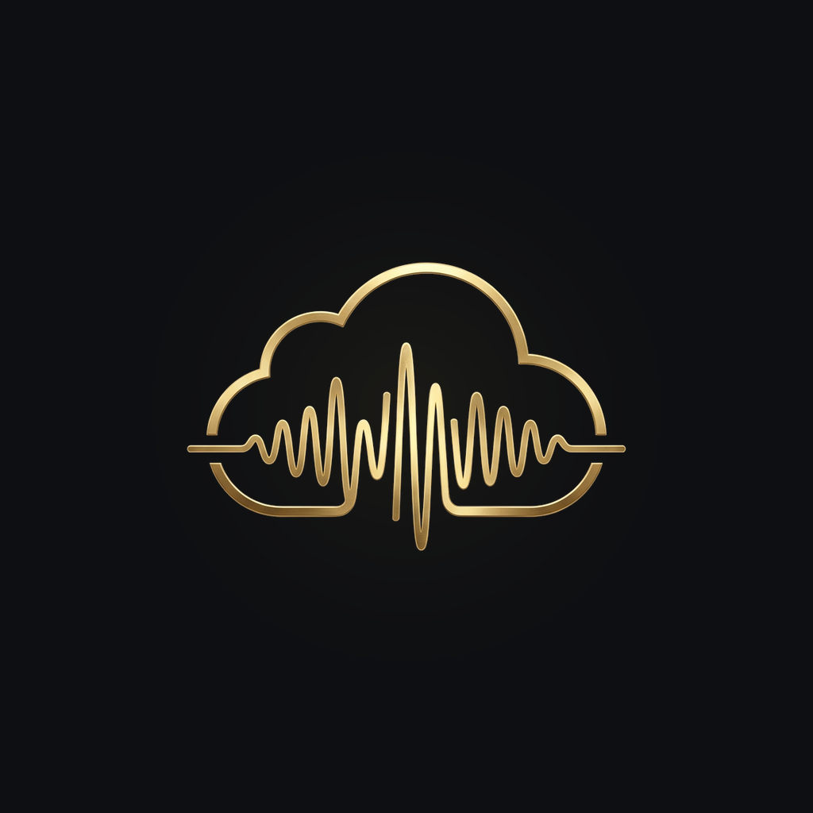

<div align="center">
  

  # BitDrop

  **Bit-Perfect Audiophile Cloud Music Player & 64-Bit DSP Processor**

  [](https://github.com/Razib99/BitDrop/releases/latest)
  [](https://github.com/Razib99/BitDrop/actions/workflows/ci.yml)
  [](https://github.com/Razib99/BitDrop/releases/latest)
  [-DEA584?style=flat-square&logo=rust)](app/rust)
  [](app)
  []()

  *Stream uncompressed lossless audio (FLAC, ALAC, WAV, AIFF, DSD64/128, DoP) directly from personal Google Drive, WebDAV/NAS, and local storage to external USB DACs and IEMs—with zero intermediate servers.*

  [**📥 Download Latest APK (v1.0.0)**](https://github.com/Razib99/BitDrop/releases/latest) · [**🏛️ Architecture Spec**](ARCHITECTURE.md) · [**📋 Verification Report**](docs/FINAL_AUDIT_VERIFICATION_REPORT.md)
</div>

---

## 🎯 Overview & Vision

Uncompressed hi-res music libraries (24-bit/96 kHz to 192 kHz FLAC/WAV and 1-bit DSD) rapidly exhaust mobile device storage. While multi-terabyte cloud storage is ubiquitous, audiophiles have historically faced a three-way compromise:

1. **Conventional Cloud Players:** Stream over the network, but route audio through the default OS mixer—forcing lossy sample-rate conversion (typically locked to 48 kHz / 16-bit) with no direct USB hardware control.
2. **Offline Audiophile Players (UAPP, Poweramp, Neutron):** Offer hardware USB DAC drivers and precision DSP, but are architected primarily around local storage or require complex manual setup.
3. **Self-Hosted Media Servers (Navidrome, Roon ARC, Plexamp):** Require provisioning, securing, and maintaining a 24/7 home server or cloud VPS.

**BitDrop eliminates the compromise.** It connects directly from your mobile device to your personal **Google Drive** (via on-device OAuth2), **WebDAV / Nextcloud / NAS**, and **Local Storage**, feeding a lock-free, double-precision (`f64`) Rust audio engine that drives external USB DACs and headphones bit-perfectly.

---

## ✨ Key Features in v1.0.0

### ☁️ Multi-Cloud & Local Storage Architecture
* **Strict Zero-Server Privacy:** Google Drive OAuth2 and WebDAV authentication happen strictly on-device. Credentials, tokens, and audio streams never pass through any intermediate server.
* **Multi-Account Cloud Support:** Mount multiple Google Drive accounts, WebDAV servers (Nextcloud, OwnCloud, Synology), and local device folders simultaneously with unified library indexing and per-source filter chips.
* **Format-Aware Progressive Header Reader:** Extracts FLAC, ALAC/MP4, ID3v2, Vorbis, and DSF metadata and embedded cover art via targeted HTTP `Range` requests in milliseconds without downloading full audio files.
* **Sparse 2 MiB Chunk Cache & Offline Pinning:** Stores audio segments in sparse disk files backed by SQLite metadata and CRC32 integrity verification—supporting instant mid-track seeks, offline track/album pinning, and configurable cache eviction limits.
* **Cellular-Aware Read-Ahead Scheduler:** Bitrate-adaptive prefetch engine scales concurrent HTTP range workers (1–4) based on network throughput and honors cellular data conservation rules while guaranteeing chunk-0 startup readiness.

### 🎛️ 64-Bit Floating-Point (`f64`) DSP & Native DSD Engine
* **Cryptographic Bit-Exact Bypass:** When all DSP stages are neutral/bypassed, the engine outputs bit-for-bit identical samples verified via SHA-256 against the source stream.
* **Native DSD64 / DSD128 & DoP v1.1:** Custom Rust DSF/DFF demuxer supporting native 1-bit $\Sigma\Delta$ streaming, DoP v1.1 marker framing for DSD-capable USB DACs, and ultra-low-CPU ($<1.5\%$) polyphase FIR decimation for PCM outputs.
* **Double-Precision Parametric & Graphic EQ:** 10-band graphic equalizer, tone controls, and arbitrary cascade parametric biquad filters (`Peak`, `LowShelf`, `HighShelf`, `LowPass`, `HighPass`) computed in 64-bit Transposed Direct Form II.
* **Built-In AutoEQ Database (4,900+ Profiles):** Ships with an indexed offline catalog of over 4,900 calibrated headphone and IEM measurements, one-tap profile application, per-device auto-switching profiles, and custom parametric EQ text import.
* **ITU-R BS.1770-4 True-Peak Limiter & ReplayGain:** 4x oversampled polyphase FIR inter-sample peak limiter (-1.0 dBFS ceiling) paired with Track/Album ReplayGain normalization and configurable preamp headroom.
* **Hardware Denormal Protection:** Enforces hardware Flush-To-Zero (`FTZ`) and Denormals-Are-Zero (`DAZ`) flags across DSP worker threads to prevent subnormal floating-point CPU spikes.

### 🔌 Honest Signal Path & Four-Tier Hardware HAL
* **Tier D — Direct User-Space USB Driver (`usbfs`):** Custom Rust USB Audio Class 2.0 (UAC2) driver using asynchronous isochronous transfers and explicit endpoint feedback pacing—bypassing Android `AudioFlinger` on Android 12+.
* **Tier A — OS Bit-Perfect Passthrough:** Uses Android 14+ `AudioMixerAttributes.MIXER_BEHAVIOR_BIT_PERFECT` and iOS `AVAudioSession` native sample-rate negotiation to bypass system mixing and software volume attenuation.
* **Tier B — Native Sample Rate:** Matches hardware clock rate to the source track without OS resampling while retaining system digital volume control.
* **Tier C — Standard Resampled Fallback:** Clean fallback using a 256-tap Blackman-Harris2 sinc resampler when hardware locks to a fixed rate (e.g., Bluetooth or internal speakers).
* **End-to-End Signal Path Inspector:** Live transparency modal detailing source codec, container bit depth, sample rate, active DSP stages, output transport tier, and target DAC hardware.
* **Hearing Safety Gate & Disconnect Protection:** Prompts for confirmation before engaging full-scale hardware bit-perfect modes (where digital volume is bypassed) and immediately pauses playback if USB DACs or headphones are unplugged.

### 🎨 Luxury OLED Interface & Playback Experience
* **True Gapless Playback:** Sample-accurate track boundary tracking over lock-free SPSC ring buffers with next-track background pre-buffering.
* **Time-Synced Lyrics (`.lrc` & Embedded):** Interactive auto-scrolling lyrics view with tap-to-seek timestamp synchronization.
* **60 FPS Real-Time Spectrum & Peak Telemetry:** 512-point Hann-windowed FFT visualizer, stereo peak meters, and buffer/network diagnostics.
* **Listening Recap & Portable Backups:** Continuous listening time analytics, top tracks/artists breakdown, and single-file JSON backup/restore of all EQ profiles and app settings.

---

## 🏛️ System Architecture

BitDrop strictly separates concerns across a reactive **Flutter presentation layer** and a single-source-of-truth **Rust audio & persistence core** connected via **Flutter Rust Bridge v2**. For deep internal specifications, see [ARCHITECTURE.md](ARCHITECTURE.md).

```text
┌──────────────────────────────────────────────────────────────────────┐
│                      Flutter / Dart UI Layer                         │
│   • Riverpod Reactive State        • Luxury OLED Dark Design System  │
│   • Android AudioService / Media   • USB Hardware Permission Broker  │
│   • AutoEQ Search & EQ Curve UI    • Signal Path & FFT Telemetry     │
└──────────────────────────────────┬───────────────────────────────────┘
                                   │
                       Flutter Rust Bridge (FRB v2)
                     Typed Async Command & Stream API
                                   │
┌──────────────────────────────────▼───────────────────────────────────┐
│                          Rust Engine Core                            │
│                                                                      │
│   ┌──────────────────────────────────────────────────────────────┐   │
│   │             Cloud Streaming, Cache & Library DB              │   │
│   │   • Symphonia Demux/Decode (FLAC, ALAC, WAV, AIFF, AAC, MP3) │   │
│   │   • Native DSD Demuxer (DSF/DFF) + DoP v1.1 Packager         │   │
│   │   • Progressive Range Header Reader & 2 MiB Sparse Cache     │   │
│   │   • SQLite Library, FTS5 Full-Text Search & Listening Stats  │   │
│   └──────────────────────────────┬───────────────────────────────┘   │
│                                  │ Lock-Free SPSC Ring Buffer        │
│   ┌──────────────────────────────▼───────────────────────────────┐   │
│   │              Real-Time Wait-Free DSP Pipeline                │   │
│   │   • Wait-Free TripleBuffer<DspConfigSnapshot>                │   │
│   │   • ReplayGain Preamp & ITU-R BS.775 Multichannel Downmix    │   │
│   │   • 64-Bit f64 Cascade Biquad Parametric & 10-Band EQ        │   │
│   │   • 256-Sinc Blackman-Harris2 Resampler (Rubato f64)         │   │
│   │   • 4x Oversampled True-Peak Limiter (-1.0 dBFS Ceiling)     │   │
│   │   • TPDF Dithering & Hardware Denormal Flushing (FTZ/DAZ)    │   │
│   └──────────────────────────────┬───────────────────────────────┘   │
│                                  │                                   │
│   ┌──────────────────────────────▼───────────────────────────────┐   │
│   │                    Hardware Output Sinks                     │   │
│   │   • Tier D: Direct Linux usbfs UAC2 Isochronous Driver       │   │
│   │   • Tier A/B/C: Android Oboe / AAudio & Desktop/iOS CPAL     │   │
│   └──────────────────────────────────────────────────────────────┘   │
└──────────────────────────────────────────────────────────────────────┘
```

---

## 🔊 Output Tier Matrix

BitDrop never fabricates signal path quality. It inspects the active hardware route and OS audio hal capabilities in real time:

| Tier | Badge | Target Route & Platform | Audio Mechanism | Volume Control |
| :--- | :--- | :--- | :--- | :--- |
| **Tier D** | `DIRECT USB` | Android 12+ with External USB DAC | Direct user-space Linux `usbfs` UAC2 asynchronous isochronous driver | Hardware DAC / UAC2 Feature Unit |
| **Tier A** | `BIT-PERFECT` | Android 14+ (API 34+) & iOS USB DACs | `MIXER_BEHAVIOR_BIT_PERFECT` / `AVAudioSession` native rate lock | Hardware DAC (Safety Gate Active) |
| **Tier B** | `NATIVE RATE` | Android 14+ / Desktop Exclusive | Hardware clock matched to track sample rate without resampling | System Digital Volume |
| **Tier C** | `RESAMPLED` | Internal Speaker, Bluetooth, Legacy OS | 64-bit Sinc resampler matched to system mixer rate (e.g., 48 kHz) | System Digital Volume |

---

## 🛡️ Automated Testing & Golden Audio CI Gates

Every change in BitDrop is validated against **389 automated tests** and **6 Golden Audio DSP verification gates**:

* **Flutter Suite (`236 tests`):** Covers `LiveBitDropCore`, settings/EQ synchronization, cellular conservation prebuffering, earphone disconnect auto-pause, gapless queue transitions, backup/restore integrity, and UI widgets.
* **Rust Suite (`153 tests`):** Covers lossless decoders, DSD/DoP framing, sparse chunk caching, CRC32 verification, HTTP exponential backoff, SQLite WAL migrations, FTS5 indexing, and UAC2 descriptor parsing.
* **Golden Audio Verification Gates:**
  1. **Gate 1 (EQ Precision):** Verifies biquad magnitude response against analytical transfer functions within $\pm 0.05\text{ dB}$.
  2. **Gate 2 (Zero Clipping):** Guarantees true-peak output never exceeds $-1.0\text{ dBFS}$ under extreme $+12\text{ dB}$ EQ boosts.
  3. **Gate 3 (Bit-Exact Neutral Bypass):** Confirms cryptographic SHA-256 bit-identity between input and output when DSP is bypassed.
  4. **Gate 4 (Frame-Exact Completion):** Verifies zero sample truncation on final decoded audio frames.
  5. **Gate 5 (Gapless Continuity):** Confirms zero-sample phase continuity across track transitions without underruns.
  6. **Gate 6 (Seek Boundary Integrity):** Validates ring-buffer flush and boundary marker realignment across rapid seeks.

---

## 📂 Repository Structure

```text
BitDrop/
├── README.md                          # Project overview, features & setup guide
├── ARCHITECTURE.md                    # Deep-dive system & DSP engineering specification
├── docs/                              # Verification reports, audits & design specs
├── app/                               # Flutter multi-platform application
│   ├── assets/                        # Adaptive icons, AutoEQ database & fonts
│   ├── lib/
│   │   ├── core_api/                  # Immutable domain models, commands & events
│   │   ├── core_live/                 # Live Rust FFI bridge, cloud auth & audio handler
│   │   ├── features/                  # UI screens (Home, Library, Now Playing, EQ, Sources)
│   │   ├── theme/                     # OLED color tokens & typography
│   │   └── widgets/                   # Signal path sheet, FFT visualizer, mini-player
│   ├── rust/                          # Rust audio engine & SQLite persistence core
│   │   ├── src/                       # Decoders, DSP pipeline, USB HAL, sparse cache
│   │   └── tests/                     # Golden audio verification suite
│   ├── android/                       # Android Kotlin host, USB permissions & themes
│   ├── ios/                           # iOS runner & CoreAudio session configuration
│   ├── linux/                         # Linux desktop runner
│   └── test/                          # 236 Flutter unit, integration & widget tests
├── spike-audio/                       # Standalone Android USB DAC hardware probe utility
└── .github/workflows/ci.yml           # Automated Rust + Flutter CI pipeline
```

---

## 🚀 Getting Started

### Download Pre-Built APK
For Android users, grab the latest signed production APK directly from [**GitHub Releases**](https://github.com/Razib99/BitDrop/releases/latest).

### Build from Source

#### Prerequisites
* **Flutter SDK:** `3.24.x` (Dart `^3.5.3`)
* **Rust Toolchain:** `1.80+` (`rustup`, `cargo`, Android NDK targets for mobile cross-compilation)
* **Android Studio / SDK:** Platform API 34, Android NDK `r26d+`
* **Java:** OpenJDK 17

#### Commands
```bash
# 1. Clone the repository
git clone https://github.com/Razib99/BitDrop.git
cd BitDrop

# 2. Run Rust engine tests & Golden Audio Gates
cd app/rust
cargo test

# 3. Install Flutter dependencies & run Dart test suite
cd ..
flutter pub get
flutter analyze lib test
flutter test

# 4. Build optimized Android release APK
JAVA_HOME=/usr/lib/jvm/java-17-openjdk-amd64 flutter build apk --release
```

---

## 📄 Documentation & References

* [**System Architecture & DSP Pipeline (`ARCHITECTURE.md`)**](ARCHITECTURE.md)
* [**Final Audit & Verification Report (`docs/FINAL_AUDIT_VERIFICATION_REPORT.md`)**](docs/FINAL_AUDIT_VERIFICATION_REPORT.md)
* [Android 14+ Preferred Mixer Attributes (AOSP)](https://source.android.com/docs/core/audio/preferred-mixer-attr)
* [USB Audio Class 2.0 Specification](https://www.usb.org/document-library/audio-devices-rev-20-and-adopters-agreement)
